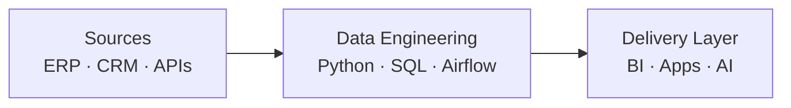
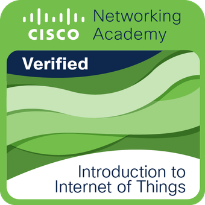

# VITÓRIA PEÇANHA

`DATA ENGINEER` · `ANALYTICS ENGINEER` · `HEAD OF TECHNOLOGY & INNOVATION`

`from raw data to business impact`

---

---

## Profile

<table>
<tr>
<td align="center"><strong>5+ years</strong> data & tech</td>
<td align="center"><strong>Python · SQL</strong> engineering core</td>
<td align="center"><strong>Airflow · APIs</strong> automation layer</td>
<td align="center"><strong>Power BI · DAX</strong> analytics delivery</td>
</tr>
</table>

## Stack

<table>
<tr>
<td valign="top"><strong>DATA</strong></td>
<td>

</td>
</tr>
<tr>
<td valign="top"><strong>ORCHESTRATION</strong></td>
<td>

</td>
</tr>
<tr>
<td valign="top"><strong>ANALYTICS</strong></td>
<td>

</td>
</tr>
<tr>
<td valign="top"><strong>AUTOMATION</strong></td>
<td>

</td>
</tr>
</table>

## Projects

<table>
<tr>
<th align="left">Public Repositories</th>
<th align="left">Core Signals</th>
</tr>
<tr>
<td><a href="https://github.com/vitoriape/etl-superlogica-mxm"><strong>etl-superlogica-mxm</strong></a></td>
<td><code>Airflow</code> <code>Python</code> <code>ERP</code></td>
</tr>
<tr>
<td><a href="https://github.com/vitoriape/pbi-docmentor"><strong>pbi-docmentor</strong></a></td>
<td><code>Power BI</code> <code>Documentation</code></td>
</tr>
<tr>
<td><a href="https://github.com/vitoriape/powerbi-api"><strong>powerbi-api</strong></a></td>
<td><code>API</code> <code>BI</code></td>
</tr>
<tr>
<td><a href="https://github.com/vitoriape/agro-sis"><strong>agro-sis</strong></a></td>
<td><code>ERP</code> <code>SQL</code> <code>UX</code></td>
</tr>
<tr>
<td><a href="https://github.com/vitoriape/kml-generator"><strong>kml-generator</strong></a></td>
<td><code>Geospatial</code> <code>Automation</code></td>
</tr>
<tr>
<td><a href="https://github.com/vitoriape/tech-cheatsheet"><strong>tech-cheatsheet</strong></a></td>
<td><code>Knowledge Base</code></td>
</tr>
</table>

<strong>Private / Enterprise Case Studies</strong>

 
<table>
<tr>
<td align="center"><strong>Corporate Data Architecture</strong> Airflow · Azure SQL · Governance</td>
<td align="center"><strong>Internal Data API</strong> FastAPI · OpenAPI · Access Control</td>
</tr>
<tr>
<td align="center"><strong>WhatsApp + Collections Kanban</strong> n8n · Zapier · CRM</td>
<td align="center"><strong>Executive KPI Dashboards</strong> Power BI · DAX · SQL</td>
</tr>
<tr>
<td align="center"><strong>Facial Recognition Integration</strong> Intranet · Hikvision · Sync</td>
<td align="center"><strong>More Repositories</strong> <a href="https://github.com/vitoriape?tab=repositories">github.com/vitoriape</a></td>
</tr>
</table>

## Metrics

  
  

  

<strong>More GitHub visuals</strong>

 

  

## Documents

## Certification

---

`BUILD` · `CONNECT` · `AUTOMATE` · `ANALYZE`

[LinkedIn](https://www.linkedin.com/in/vitoria-pecanha/) · [GitHub](https://github.com/vitoriape) · [Email](mailto:vitoriapecanha.log@gmail.com)

